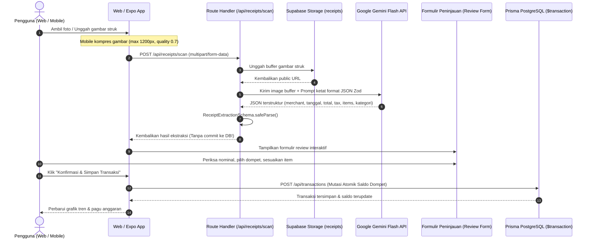
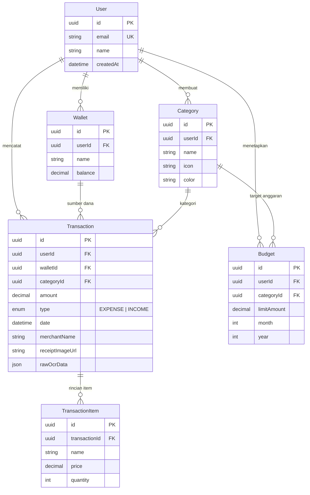

# FinTrack AI — Personal Finance & OCR Receipt Scanner (Web & Mobile)

Aplikasi **Personal Finance & Expense Tracker** siap produksi untuk portofolio tingkat lanjut (*Senior/Lead Fullstack Engineer*), dilengkapi fitur pemindaian struk belanja fisik otomatis berbasis **Vision AI (Google Gemini Flash & OpenAI Vision)** dengan validasi kontrak data Zod, mutasi saldo dompet atomik (`prisma.$transaction`), dasbor analitik Recharts, dan aplikasi mobile Expo React Native.

---

## 🏛️ Arsitektur Sistem & Tech Stack

Proyek ini dibangun menggunakan arsitektur **Monorepo** modern berbasis **pnpm workspaces** dan **Turborepo**:

```
finance-tracker/
├── apps/
│   ├── web/               # Next.js 14 (App Router, Route Handlers, Recharts, Tailwind CSS)
│   └── mobile/            # React Native Expo (Expo Camera, Image Manipulator, TanStack Query)
└── packages/
    ├── database/          # Prisma ORM + Client singleton (PostgreSQL / Supabase / Neon)
    └── shared/            # Kontrak Zod & TypeScript types terpadu untuk Web & Mobile
```

### Tech Stack:
- **Web App:** Next.js 14, React 18, Tailwind CSS, Recharts, Lucide Icons.
- **Mobile App:** React Native via Expo SDK 51, Expo Camera, Expo Image Manipulator, TanStack React Query.
- **Data Layer:** PostgreSQL (Supabase / Neon), Prisma ORM v5, Supabase Storage (bucket `receipts`).
- **AI Extraction Engine:** Google Gemini Flash (`gemini-1.5-flash`) dengan `responseMimeType: "application/json"`, fallback ke OpenAI Vision (`gpt-4o-mini`).
- **Validasi & Type Safety:** Zod v3 dengan *Zero Incomplete Implementations* dan *Strict Typing*.

---

## 🚀 Alur Kerja Pemindaian Struk (OCR Vision AI)



---

## ⚙️ Skema Basis Data Relasional



---

## 🔒 Aturan Integritas Dompet Atomik (`prisma.$transaction`)

1. **Pembuatan Transaksi (`createTransaction`):**
   - Jika bertipe `EXPENSE`: Saldo dompet berkurang sebesar `amount`.
   - Jika bertipe `INCOME`: Saldo dompet bertambah sebesar `amount`.
2. **Pembaruan Transaksi (`updateTransaction`):**
   - Efek mutasi lama dibatalkan (*reverted*).
   - Efek mutasi baru diaplikasikan (*applied*), mendukung pemindahan antar dompet yang berbeda tanpa ketidakkonsistenan saldo.
3. **Penghapusan Transaksi (`deleteTransaction`):**
   - Transaksi dibatalkan secara atomik dan saldo dompet dikembalikan ke posisi semula sebelum data transaksi dihapus.

---

## 🛠️ Panduan Menjalankan Proyek

### 1. Klon & Pasang Dependensi
```powershell
cd C:\Users\dandy\.gemini\antigravity\scratch\finance-tracker
pnpm install
```

### 2. Konfigurasi Lingkungan (`.env`)
Salin berkas `.env.example` ke `.env`:
```powershell
cp .env.example .env
```
Isi variabel berikut:
```env
# Database PostgreSQL (Supabase / Neon)
DATABASE_URL="postgresql://postgres:[PASSWORD]@[HOST]:6543/postgres?pgbouncer=true"
DIRECT_URL="postgresql://postgres:[PASSWORD]@[HOST]:5432/postgres"

# Supabase Storage
NEXT_PUBLIC_SUPABASE_URL="https://[PROJECT-ID].supabase.co"
SUPABASE_SERVICE_ROLE_KEY="your-service-role-key"
SUPABASE_RECEIPT_BUCKET="receipts"

# Vision AI Engine (Google Gemini Flash)
GEMINI_API_KEY="AIzaSy..."
GEMINI_MODEL="gemini-1.5-flash"
```
*(Catatan: FinTrack dilengkapi **DemoStore lokal** & **Mock AI Mode** otomatis jika API Key atau Database belum dikonfigurasi, sehingga aplikasi dapat dicoba langsung tanpa setup cloud).*

### 3. Migrasi & Seeding Basis Data
```powershell
pnpm --filter @fintrack/database db:push
npx tsx packages/database/prisma/seed.ts
```

### 4. Menjalankan Web Dashboard
```powershell
pnpm --filter @fintrack/web dev
```
Akses di browser: **`http://localhost:3000`**

### 5. Menjalankan Mobile App (Expo)
```powershell
pnpm --filter @fintrack/mobile start
```
Pindai QR code via aplikasi **Expo Go** di Android/iOS atau jalankan di simulator/emulator.

---

## 🧪 Validasi & Pengujian

- **Verifikasi Skema Zod:**
  ```powershell
  npx tsx verify-phase1.ts
  ```
- **Typecheck Bebas Error Seluruh Monorepo:**
  ```powershell
  pnpm -r exec tsc --noEmit
  ```
- **Kompilasi Build Produksi Turborepo:**
  ```powershell
  pnpm build
  ```
  *(Status: 3/3 packages build successful in <20s)*
