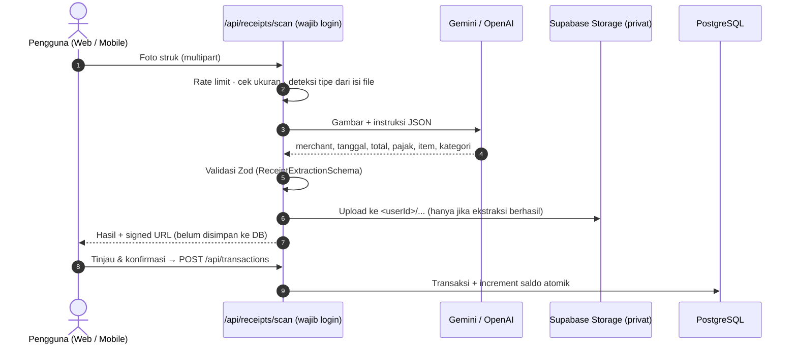
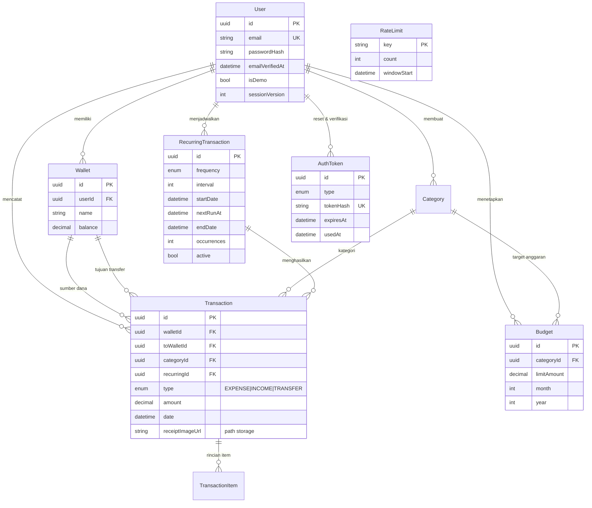

# FinTrack AI — Personal Finance & OCR Receipt Scanner (Web & Mobile)

Aplikasi **Personal Finance & Expense Tracker** untuk web dan mobile: pemindaian struk otomatis dengan **Vision AI (Google Gemini, cadangan OpenAI)**, kantong (rekening/e-wallet/tunai) dengan transfer antar kantong, anggaran per kategori, transaksi berulang, laporan 12 bulan, dan akun yang aman (reset kata sandi, verifikasi email, ekspor & hapus data).

---

## 🏛️ Arsitektur Sistem & Tech Stack

Monorepo berbasis **pnpm workspaces** dan **Turborepo**:

```
fintrack/
├── apps/
│   ├── web/               # Next.js 14 (App Router, Route Handlers, Recharts, Tailwind CSS)
│   └── mobile/            # React Native Expo (Expo Camera, Image Manipulator)
└── packages/
    ├── database/          # Prisma schema, migrasi, seed, client singleton (PostgreSQL)
    └── shared/            # Kontrak Zod & tipe TypeScript bersama untuk server, web, dan mobile
```

### Tech Stack
- **Web:** Next.js 14 (App Router), React 18, Tailwind CSS, TanStack Query, Radix UI, Framer Motion, Recharts (lazy-loaded), Lucide Icons.
- **Mobile:** React Native via Expo SDK 51, Expo Camera, Expo Image Manipulator, Expo SecureStore.
- **Data:** PostgreSQL (Supabase / Neon) via Prisma 5 dengan **migrasi berversi**; Supabase Storage (bucket **privat** `receipts`).
- **AI:** Google Gemini (`gemini-flash-latest` secara default, bisa diganti lewat `GEMINI_MODEL`), cadangan OpenAI Vision.
- **Kualitas:** Zod di setiap batas API, Vitest (unit, kontrak store, dan API) dijalankan di memori dan di PostgreSQL, ESLint, CI GitHub/GitLab.

### Lapisan server (`apps/web/lib/server/`)

| Modul | Isi |
|---|---|
| `store/` | Satu antarmuka `FinanceStore` dengan dua implementasi: **PostgreSQL** (`prisma-store.ts`) dan **memori** (`memory-store.ts`). Mode dipilih dari konfigurasi (`DATABASE_URL`); error database **tidak pernah** diam-diam dialihkan ke memori. |
| `domain/` | Aturan murni yang dipakai kedua store: efek saldo (`balance.ts`), analitik & laporan (`analytics.ts`), jadwal berulang (`recurrence.ts`), data contoh demo. |
| `services/` | Alur bisnis: akun (registrasi, login, reset, verifikasi, hapus/ekspor), transaksi, transaksi berulang, analitik. |
| `auth.ts`, `http.ts`, `errors.ts` | `withUser()` mewajibkan sesi di setiap route privat; error internal dicatat dan tidak pernah dikirim ke klien. |
| `receipts.ts`, `rate-limit.ts`, `mailer.ts`, `logger.ts` | Penyimpanan struk privat + signed URL, rate limit bersama, email (Resend), log JSON + pelaporan error opsional ke Sentry. |

---

## ✨ Fitur

- **Transaksi:** pengeluaran, pemasukan, dan **transfer antar kantong** (tidak dihitung sebagai pemasukan/pengeluaran), item belanja, filter, pencarian (tidak peka huruf besar/kecil, termasuk nama kategori), ekspor CSV di server tanpa batas baris dan aman dari *CSV injection*.
- **Kantong:** buat, ubah nama, koreksi saldo; menghapus kantong yang masih punya transaksi wajib memilih *pindahkan ke kantong lain* atau *hapus semuanya*.
- **Anggaran:** batas bulanan per kategori, salin dari bulan sebelumnya; kategori tanpa anggaran tidak dianggap "melebihi anggaran".
- **Kategori kustom:** ikon & warna sendiri; kategori bawaan bersifat baca-saja.
- **Transaksi berulang:** harian/mingguan/bulanan/tahunan dengan interval, tanggal mulai (mengisi kejadian yang terlewat) & selesai, jeda/lanjutkan. Diproses otomatis saat aplikasi dibuka dan oleh cron harian.
- **Laporan:** 6/12/24 bulan — pemasukan vs pengeluaran, rasio tabungan, bulan terbaik/terberat, pengeluaran per kategori, tabel bulanan.
- **Akun:** reset kata sandi via email, verifikasi email, ganti nama/email/kata sandi, keluar dari semua perangkat, unduh semua data (JSON), hapus akun permanen.
- **Demo:** setiap pengunjung mendapat **sandbox pribadi** berisi data contoh 3 bulan; dihapus otomatis setelah 24 jam.
- **Halaman publik:** landing page untuk tamu di `/`, Kebijakan Privasi, Ketentuan, halaman 404/error.

---

## 🔒 Keamanan

| Area | Implementasi |
|---|---|
| Autentikasi | Setiap route privat memakai `withUser()` → 401 tanpa sesi valid (diuji otomatis untuk **semua** route). Middleware memverifikasi tanda tangan & kedaluwarsa token. |
| Sesi | Token HS256 (Web Crypto) dengan `SESSION_SECRET` **wajib** di produksi. Versi sesi di database: ganti/reset kata sandi dan "keluar dari semua perangkat" mencabut semua sesi lain. |
| Kata sandi | scrypt (N=2¹⁵); hash PBKDF2 lama tetap bisa login dan otomatis di-upgrade. Perbandingan *constant-time*; email tidak terdaftar memakan waktu yang sama (anti enumerasi). Minimal 8 karakter. |
| Rate limit | Login (per IP & per akun), registrasi, reset kata sandi, pemindaian struk, dan pembuatan demo — penghitung disimpan di database sehingga berlaku di semua instance serverless. |
| Struk | Bucket privat, path ditentukan dari sesi, signed URL 1 jam, tipe file diperiksa dari *magic bytes* (bukan label MIME), upload hanya setelah ekstraksi berhasil. |
| Respons | Error internal tidak pernah bocor; header keamanan (CSP, HSTS, `frame-ancestors 'none'`, Permissions-Policy); respons API `Cache-Control: no-store`. |

---

## 🚀 Alur Pemindaian Struk



---

## ⚙️ Skema Basis Data



Migrasi ada di `packages/database/prisma/migrations/` (`0_init` = skema awal, lalu perubahan berikutnya).

## 🧮 Aturan Saldo

Semua perubahan saldo berasal dari satu fungsi (`lib/server/domain/balance.ts`) dan diterapkan dengan **increment atomik**, sehingga transaksi yang berjalan bersamaan tidak saling menimpa:

| Jenis | Efek |
|---|---|
| `EXPENSE` | kantong − jumlah |
| `INCOME` | kantong + jumlah |
| `TRANSFER` | kantong asal − jumlah, kantong tujuan + jumlah |

Mengedit transaksi menerapkan selisih (efek baru − efek lama) dengan baris transaksi dikunci (`SELECT … FOR UPDATE`); menghapus transaksi membalik efeknya. Kejadian transaksi berulang "diklaim" secara atomik sehingga tidak pernah tercatat ganda.

---

## 🛠️ Menjalankan Proyek

### 1. Pasang dependensi
```bash
pnpm install
```

### 2. Konfigurasi `.env`
```bash
cp .env.example .env
```
Minimal untuk produksi: `SESSION_SECRET`, `DATABASE_URL`/`DIRECT_URL`, `APP_URL`. Lihat komentar di `.env.example` untuk Supabase Storage, Gemini, email (Resend), cron, dan Sentry.

Tanpa `DATABASE_URL`, aplikasi berjalan di **mode memori** (cocok untuk mencoba lokal): data hilang saat server restart, dan aplikasi menampilkan pemberitahuan tentang hal itu.

### 3. Database
```bash
pnpm db:deploy          # terapkan semua migrasi
pnpm --filter @fintrack/database db:seed   # opsional: akun lokal dandy@example.com / password123
```

### 4. Web
```bash
pnpm --filter @fintrack/web dev
```
Buka `http://localhost:3000`.

### 5. Mobile (Expo)
```bash
pnpm --filter @fintrack/mobile start
```
Atur `EXPO_PUBLIC_API_URL` ke alamat server web. Untuk BlueStacks: `apps/mobile/scripts/connect-bluestacks.ps1 -ExpoUrl exp://<IP-LAN>:8081`.

---

## 🧪 Pengujian

```bash
pnpm typecheck                       # shared, database, web
pnpm --filter @fintrack/web lint     # ESLint (next/core-web-vitals)
pnpm test                            # unit + kontrak store + API (store memori)
TEST_DATABASE_URL=postgresql://…/fintrack_test pnpm test:integration   # kontrak store + API di PostgreSQL
```

- **Kontrak store** (`tests/store/contract.ts`): rangkaian tes yang sama dijalankan untuk memori dan PostgreSQL — termasuk 25 transaksi paralel, dua edit bersamaan, dan pemrosesan transaksi berulang yang bersamaan.
- **API** (`tests/api/api.test.ts`): memastikan **setiap** route privat menolak permintaan tanpa sesi, serta alur registrasi, login, rate limit, reset kata sandi, demo terisolasi, pemindaian struk, transfer, anggaran, transaksi berulang, dan ekspor CSV.
- `TEST_DATABASE_URL` harus menunjuk database yang namanya mengandung "test" (isinya dikosongkan setiap tes).

CI (`.github/workflows/ci.yml`, `.gitlab-ci.yml`) menjalankan typecheck, lint, tes unit, migrasi + cek *drift* skema, tes integrasi PostgreSQL, dan build.

---

## 🎨 Sistem Desain Web — "Aurora Ledger"

Tata letak tenang yang mengutamakan angka, dengan sedikit momen visual khas (aurora pada saldo, kartu kantong yang miring mengikuti kursor, dan sinar pemindai struk).

| Lapisan | Lokasi | Isi |
|---|---|---|
| Token desain | `apps/web/app/globals.css`, `tailwind.config.ts` | Warna berbasis peran (`surface`, `fg`, `brand`, `ai`, `positive`, `negative`, `warning`) untuk mode terang & gelap. |
| Komponen dasar | `apps/web/components/ui/` | Button, Field, AmountInput, Money (mode privasi + animasi angka), Dialog/Sheet/Drawer responsif (Radix + vaul), ConfirmDialog, SegmentedControl, Skeleton, EmptyState. |
| Data | `apps/web/lib/api/` | Klien bertipe + hook TanStack Query; layout aplikasi melakukan *prefetch* di server. |
| Format & i18n | `apps/web/lib/format.ts`, `lib/i18n/` | Format Rupiah/tanggal terpusat; seluruh teks EN/ID ada di kamus (paritas dijaga oleh TypeScript). |
| Grafik | `components/reports`, `components/dashboard/charts.tsx` | Pasangan warna biru/oranye yang lolos uji buta warna di kedua tema, dengan legenda, tooltip, dan tabel. |

**Fitur UX:** daftar transaksi per hari dengan *infinite scroll* · detail transaksi dengan ubah/hapus + *Undo* · pemindai struk dengan seret-lepas, tempel, dan kamera · pemilih bulan · mode privasi saldo · palet perintah (`⌘K`) dan pintasan `N`, `S`, `/` · navigasi bawah di ponsel dengan menu "Lainnya".
